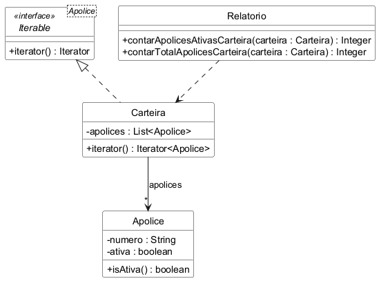

# Iterator

Trabalho da disciplina Aspectos Avançados em Engenharia de Software.

Exemplo do padrão Iterator em Java, com testes em JUnit 5. O tema é o mesmo da
seguradora usada nos trabalhos anteriores: um corretor tem uma carteira de
apólices, e o relatório precisa saber quantas apólices tem na carteira e
quantas delas estão ativas.

A `Carteira` implementa a interface `Iterable` do Java, então o `Relatorio`
consegue percorrer as apólices uma por uma sem saber como elas estão guardadas
dentro da carteira.

## Diagrama de classes

